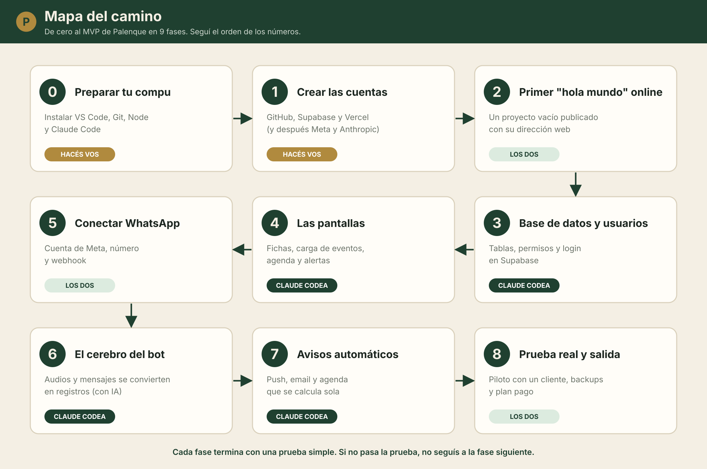
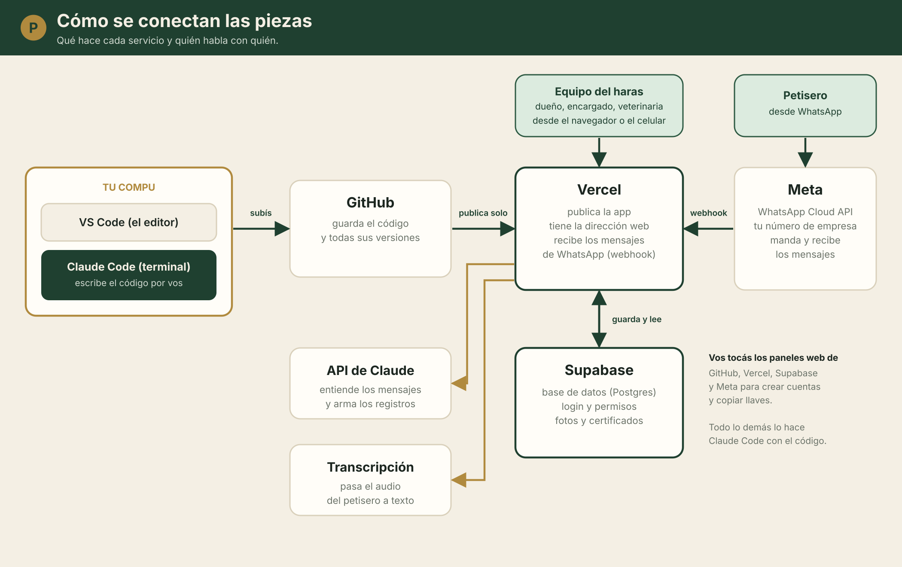
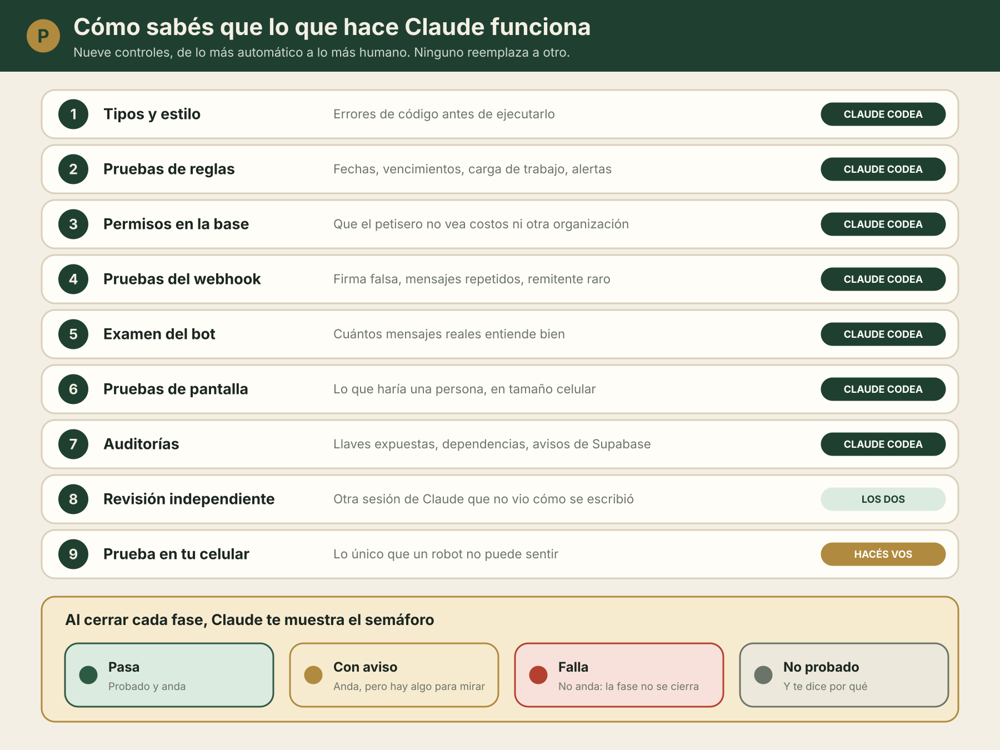
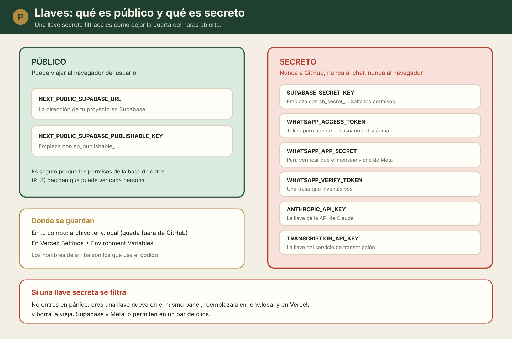
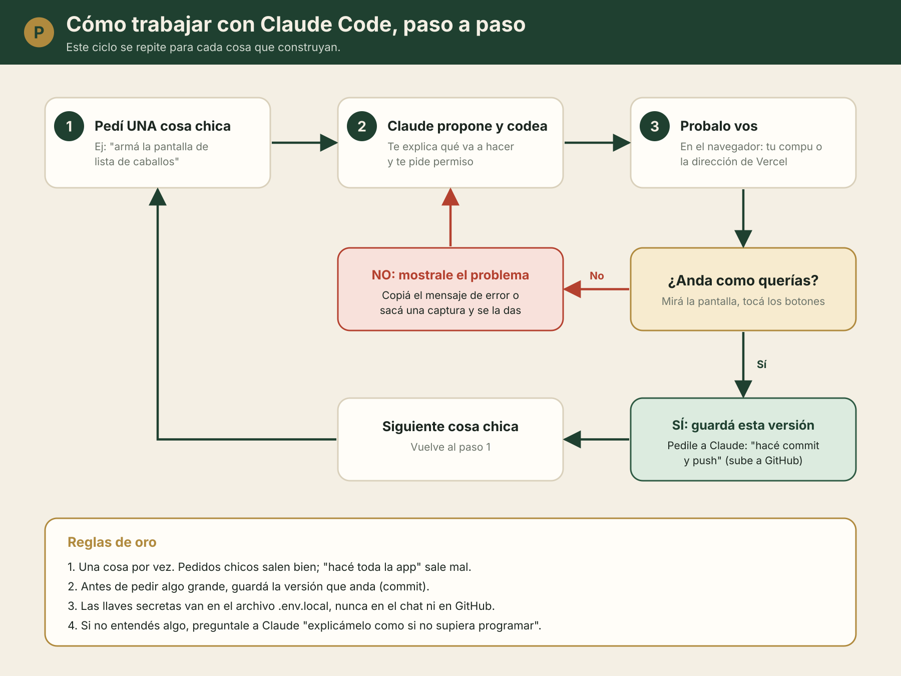
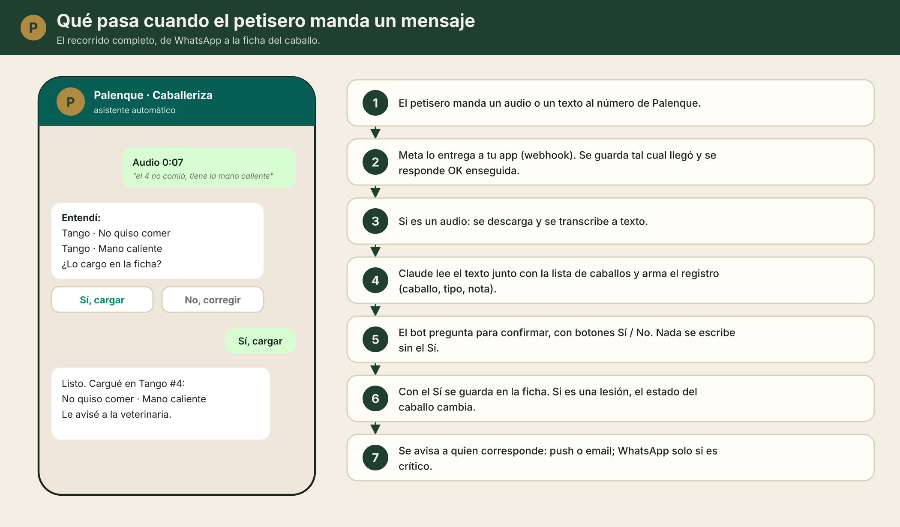

# Palenque · Guía paso a paso para construir el MVP sin saber programar

Versión del 3 de noviembre de 2026. Los precios y las pantallas de los servicios cambian seguido: donde importa, te dejo el link oficial para confirmar.

---

## 0. Cómo usar esta guía

Esta guía la leen dos personas a la vez:

- **Vos**: te dice qué cuentas crear, qué botones tocar y qué probar.
- **Claude Code** (el Claude de la terminal): lee la misma guía, te acompaña fase por fase, escribe todo el código y te avisa cuándo te toca a vos.

### Arranque (una sola vez)

1. Seguí la **Fase 0** y la **Fase 1** de abajo (preparar la compu y crear cuentas). Eso lo hacés vos con la guía en la mano.
2. Descomprimí el zip dentro de tu carpeta `palenque`. Tiene que quedar así:

```
palenque/
├── CLAUDE.md                      ← Claude Code lo lee solo al arrancar
└── docs/
    ├── GUIA-MVP-PALENQUE.md       ← esta guía
    ├── ESPECIFICACION-PALENQUE.md ← qué se construye, en detalle técnico
    ├── imagenes/                  ← los diagramas
    └── prototipo/Palenque-prototipo.html  ← el prototipo actual
```

3. Abrí la terminal dentro de esa carpeta, escribí `claude` y pegá este mensaje:

```
Leé CLAUDE.md, docs/GUIA-MVP-PALENQUE.md y docs/ESPECIFICACION-PALENQUE.md.
Soy una persona que no sabe programar y vamos a construir el MVP de Palenque juntos.
Revisá en qué fase estamos (mirá el historial de git y los archivos que ya existen),
decime en palabras simples qué sigue y guiame paso a paso. Una cosa por vez.
```

Claude Code te va a preguntar permiso antes de crear archivos o correr comandos. Podés leer lo que propone y aceptar. Si no entendés algo, escribile: "explicámelo como si no supiera programar".

### Qué NO está en esta guía

Capturas de pantalla de Supabase, Vercel o Meta. Esas pantallas cambian cada pocas semanas y una captura vieja confunde más de lo que ayuda. En su lugar te doy el **nombre exacto de cada botón, en inglés, tal cual aparece**. Si no encontrás algo: sacá una captura de tu pantalla, arrastrala a la terminal de Claude Code (o pegala con Ctrl+V) y preguntale dónde tocar.

> **Para Claude Code. Reglas de trabajo con esta persona:**
>
> 1. **Hablá en castellano rioplatense (voseo), simple y directo.** La persona no programa. Explicá cada cosa en una frase antes de hacerla.
> 2. **Una fase por vez, una tarea chica por vez.** No avances a la fase siguiente hasta que la prueba de la fase actual pase. Decile cuál es la prueba y cómo verla.
> 3. **Verificá cada paso.** Después de cada instalación o comando, comprobá que anduvo (`--version`, abrir la página, mirar el log). Si falla, diagnosticá vos primero.
> 4. **Secretos.** Nunca le pidas que pegue una llave secreta en el chat. Creá `.env.local` con los nombres de variables vacíos y pedile que pegue los valores directamente en el archivo desde VS Code. Verificá que `.env*` esté en `.gitignore` **antes** del primer commit y nunca imprimas el contenido de esos archivos.
> 5. **Acciones que tienen que confirmar siempre:** borrar archivos o datos, `git push --force`, resetear la base de datos remota, cambiar de plan o ingresar un medio de pago, enviar mensajes reales de WhatsApp a números que no sean los de prueba.
> 6. **Verificá la documentación vigente** antes de usar APIs que cambian (Meta Graph API, Supabase, Vercel, Next.js, SDK de Anthropic, transcripción). Esta guía puede estar desactualizada en detalles. Si algo contradice la documentación oficial, ganá la documentación y avisale a la persona.
> 7. **Commits chicos y frecuentes**, con mensajes en castellano que describan qué cambió. Después de cada tarea que anda, ofrecé hacer commit y push.
> 8. **No instales Docker ni uses `supabase start`.** Se trabaja contra el proyecto de Supabase en la nube con migraciones (`supabase/migrations`) y `supabase db push`.
> 9. Si la persona te manda una captura de pantalla, leela y guiala sobre qué botón tocar.
> 10. Al terminar cada fase, resumí en 3 líneas: qué quedó andando, qué probar y qué sigue.
> 11. **Pruebas y auditorías (sección 14 de la especificación).** Cada cosa que construyas lleva sus pruebas. No digas "anda" sin haber corrido `npm run verify` y mostrado el resultado real. Nunca debilites ni borres una prueba para ponerla en verde. Al cerrar cada fase mostrá el semáforo y escribí `docs/informes/fase-N.md`. Lo que no pudiste probar, decilo como "no probado".

---

## 1. El mapa del camino



| Fase | Qué se logra | Quién |
|---|---|---|
| 0 | La compu lista: editor, Git, Node y Claude Code | Vos |
| 1 | Cuentas de GitHub, Supabase y Vercel | Vos |
| 2 | Un proyecto vacío publicado en internet | Los dos |
| 3 | Base de datos, usuarios y permisos | Claude |
| 4 | Las pantallas de la app (instalable en el celular) | Claude |
| 5 | WhatsApp conectado (cuenta de Meta, número, webhook) | Los dos |
| 6 | El bot que entiende audios y mensajes | Claude |
| 7 | Avisos y agenda automática | Claude |
| 8 | Prueba con un cliente real y salida a producción | Los dos |

## 2. Cómo se conectan las piezas



**Glosario mínimo**

| Palabra | Qué es, en criollo |
|---|---|
| Terminal | Una ventana donde se escriben órdenes con texto. Claude Code vive ahí. |
| Repositorio (repo) | La carpeta del proyecto guardada en GitHub, con todas sus versiones. |
| Commit | "Sacar una foto" de cómo está el proyecto en este momento, para poder volver. |
| Push | Subir esas fotos a GitHub. |
| Deploy | Publicar la app para que se abra desde internet. Vercel lo hace solo cuando hacés push. |
| Base de datos | Donde viven los caballos, eventos y usuarios. Es Supabase. |
| Migración | Un archivo con cambios a la base de datos (crear una tabla, por ejemplo). |
| RLS | "Seguridad por fila": reglas en la base de datos que dicen quién puede ver qué. |
| Variable de entorno | Un dato de configuración (por ejemplo una llave) que no va dentro del código. |
| Webhook | La dirección de tu app a la que Meta le avisa "llegó un mensaje". |
| PWA | Una web que se instala en el celular como si fuera una app. |

## 3. Qué vas a necesitar y cuánto cuesta

| Servicio | Para qué | Mientras desarrollás | Con un cliente real |
|---|---|---|---|
| **Claude** (suscripción paga, o créditos de API en la Consola) | Que Claude Code escriba el código | Plan vigente en [claude.ai](https://claude.ai) | Igual |
| **GitHub** | Guardar el código | Gratis | Gratis |
| **Supabase** | Base de datos, login, fotos | Plan Free: se pausa tras 1 semana sin actividad y no incluye backups automáticos | Plan Pro desde USD 25/mes por organización (más cómputo; trae USD 10 de crédito). No se pausa y tiene backups diarios de 7 días |
| **Vercel** | Publicar la app | Plan Hobby gratis, **solo para uso personal no comercial** | Plan Pro: USD 20 por usuario por mes. Obligatorio para uso comercial |
| **Meta (WhatsApp Cloud API)** | Número de WhatsApp de empresa y mensajes | Número de prueba gratis | Cobra por mensaje según categoría y país. Ver la nota de abajo |
| **API de Anthropic** | Que el bot entienda los mensajes | Pago por uso | Pago por uso |
| **Transcripción de audio** (OpenAI, por defecto) | Pasar los audios a texto | Pago por uso | Pago por uso |
| **Resend** (opcional) | Mandar emails de aviso | Plan gratuito | Según volumen |

**Dos reglas de Meta que hay que conocer antes de empezar WhatsApp:**

- **Desde el 15 de enero de 2026 Meta no permite asistentes de IA generalistas en la API de WhatsApp Business.** Los bots para tareas concretas de un negocio sí están permitidos. El bot de Palenque carga novedades de caballos, o sea una tarea concreta. Mientras no lo dejemos charlar de cualquier tema, está del lado permitido.
- **Desde el 1 de octubre de 2026 Meta cobra por mensaje también las respuestas libres dentro de la ventana de 24 horas** y los templates utility dentro de esa ventana. Una de las fuentes consultadas indica que las primeras 1.000 respuestas por número al mes salen gratis, pero las fuentes no coinciden del todo. **Confirmá la tarifa vigente para Argentina en el panel de Meta** antes de prometerle un costo a un cliente. Por eso el bot manda **una sola respuesta por mensaje** del petisero.

Guardá todas las contraseñas y llaves en un gestor de contraseñas (Bitwarden, 1Password o el de tu navegador). Vas a manejar muchas.

### Cómo sabés que lo que hace Claude funciona

No hace falta que leas el código. Claude Code tiene que **demostrarlo** con pruebas automáticas y auditorías, y avisarte con un semáforo. Son nueve controles, y los primeros siete los corre Claude solo:



**Lo que tenés que saber como no programador:**

- Cada cosa nueva viene con sus pruebas. Si Claude dice "anda" y no te mostró el resultado de `npm run verify`, preguntale: *"¿corriste verify? Mostrame el resultado."*
- Claude **no puede** borrar ni apagar pruebas para que den verde. Si lo hace, es una falla grave: pedile que lo deshaga.
- Una prueba en verde no es garantía total. Por eso hay una revisión independiente (otra sesión de Claude que no escribió el código) al final de las fases 3, 5, 6 y 8, y por eso la prueba en tu celular sigue siendo obligatoria.
- Las pruebas corren contra un **segundo proyecto de Supabase llamado `palenque-test`** con datos inventados. Nunca tocan tus datos reales ni mandan WhatsApp reales. Lo creás en la Fase 1.
- Lo más caro que corre es el "examen del bot", que usa la API de Claude: son unos centavos por corrida y Claude te avisa antes.
- Al cerrar cada fase vas a ver un **semáforo**: 🟢 pasa, 🟡 anda pero con aviso, 🔴 falla, ⚪ no probado. Con un 🔴 no se avanza. Con un 🟡 decidís vos y queda anotado en el informe de la fase (`docs/informes/fase-N.md`).

---

## FASE 0 · Preparar tu compu

**Hacés vos.** Todo esto se hace una sola vez. Si usás Windows, los comandos van en **PowerShell** (el prompt empieza con `PS C:\`). Si usás Mac, en **Terminal**.

### 0.1 Instalar VS Code (el editor)

1. Entrá a [code.visualstudio.com](https://code.visualstudio.com), descargá la versión para tu sistema e instalala (siguiente, siguiente, finalizar).
2. Abrilo. No hace falta configurar nada.

Para qué lo vamos a usar: para **mirar** los archivos, pegar las llaves en `.env.local` y tener la terminal a mano. El código lo escribe Claude.

### 0.2 Instalar Git

- **Windows**: descargá el instalador de [git-scm.com/downloads/win](https://git-scm.com/downloads/win) y aceptá todas las opciones por defecto. Claude Code en Windows funciona mejor con Git instalado.
- **Mac**: en Terminal escribí `git --version`. Si no lo tenés, Mac te ofrece instalar las herramientas de desarrollo: aceptá.

Después, presentate (una vez):

```
git config --global user.name "Tu Nombre"
git config --global user.email "tu-email@ejemplo.com"
```

Usá el mismo email con el que vas a crear la cuenta de GitHub.

### 0.3 Instalar Node.js

1. Entrá a [nodejs.org](https://nodejs.org) y descargá la versión marcada **LTS** (la estable).
2. Instalala con las opciones por defecto.

### 0.4 Instalar Claude Code

Necesitás una cuenta de Claude con un plan pago (o créditos de API en la Consola de Anthropic). Los planes vigentes los ves en [claude.ai](https://claude.ai).

- **Windows (PowerShell):**
  ```
  irm https://claude.ai/install.ps1 | iex
  ```
- **Mac o Linux (Terminal):**
  ```
  curl -fsSL https://claude.ai/install.sh | bash
  ```
  (En Mac también podés usar `brew install --cask claude-code` si ya usás Homebrew.)

El instalador no muestra progreso mientras descarga: esperá a que termine. Después **cerrá la terminal y abrí una nueva**.

Si preferís una interfaz gráfica, Anthropic ofrece una app de escritorio para macOS y Windows con Claude Code. Esta guía asume la terminal porque es la más simple de seguir. Documentación oficial: [code.claude.com/docs/en/install](https://code.claude.com/docs/en/install.md). Si nunca usaste una terminal, Anthropic tiene una [guía de terminal para principiantes](https://code.claude.com/docs/en/terminal-guide).

### 0.5 Crear la carpeta del proyecto

1. Abrí VS Code → menú **File → Open Folder…**
2. Creá una carpeta nueva llamada `palenque` (por ejemplo en Documentos) y abrila.
3. Abrí la terminal integrada: menú **Terminal → New Terminal** (atajo: Ctrl + ` ). Ya está parada dentro de `palenque`.
4. Descomprimí ahí el zip de esta guía (que quede `CLAUDE.md` y la carpeta `docs/` adentro de `palenque/`).

### 0.6 Primer contacto con Claude Code

En esa terminal:

```
claude
```

La primera vez se abre el navegador para que inicies sesión con tu cuenta de Claude. Autorizá y volvé a la terminal. Va a preguntarte si confiás en esta carpeta: decí que sí.

> ✅ **Prueba de la Fase 0.** Tenés que poder correr estos tres comandos y que cada uno muestre un número de versión (no un error):
>
> ```
> git --version
> node -v
> claude --version
> ```
>
> Y al escribir `claude` en la carpeta `palenque`, aparece el chat de Claude Code.

**Si algo falla:** `claude: command not found` casi siempre se arregla cerrando y abriendo la terminal. Para cualquier otro error, copiá el mensaje completo y pegalo en una conversación normal con Claude.

---

## FASE 1 · Crear las cuentas

**Hacés vos.** Orden recomendado: GitHub primero, porque con esa cuenta entrás a las otras dos.

### 1.1 GitHub

1. Entrá a [github.com/signup](https://github.com/signup) y creá la cuenta. Confirmá el email.
2. Activá la verificación en dos pasos: **Settings → Password and authentication → Two-factor authentication**. Es opcional pero muy recomendable.
3. Creá el repositorio: entrá a [github.com/new](https://github.com/new).
   - **Repository name:** `palenque`
   - **Private** (privado)
   - **No** marques "Add a README", ni `.gitignore`, ni licencia. Claude los crea.
   - Tocá **Create repository**.
4. Instalá la herramienta `gh`, que permite a Claude Code hablar con GitHub:
   - **Windows:** `winget install --id GitHub.cli`
   - **Mac:** `brew install gh`, o el instalador de [cli.github.com](https://cli.github.com)
5. Iniciá sesión (cerrá y abrí la terminal antes si no encuentra el comando):
   ```
   gh auth login
   ```
   Elegí: **GitHub.com → HTTPS → Login with a web browser**. Te muestra un código de 8 caracteres: copialo, pegalo en la página que se abre y tocá **Authorize**.

> ✅ **Prueba:** `gh auth status` dice que estás logueado en github.com.

> **Para Claude Code:** si necesitás que la persona corra un comando interactivo (como `gh auth login`), decile que lo escriba con `!` adelante en esta misma sesión (por ejemplo `! gh auth login`) o en otra pestaña de la terminal.

### 1.2 Supabase (la base de datos)

1. Entrá a [supabase.com](https://supabase.com) → **Sign in → Continue with GitHub**.
2. Tocá **New project** y completá:
   - **Name:** `palenque`
   - **Database Password:** usá **Generate a password** y guardala en tu gestor de contraseñas. **Es secreta.** Después te la va a pedir un comando.
   - **Region:** **South America (São Paulo)**. Es la más cercana a Argentina.
   - Plan: el que viene por defecto (Free) alcanza para desarrollar.
3. Tocá **Create new project** y esperá un par de minutos.
4. Más adelante vas a necesitar tres datos (los copiás recién en la Fase 2):
   - La **URL del proyecto** (algo como `https://abcdefgh.supabase.co`). La parte `abcdefgh` es el **project ref**.
   - La **Publishable key** (empieza con `sb_publishable_`). Es la llave pública.
   - La **Secret key** (empieza con `sb_secret_`). Es la llave **secreta**.
   
   Las claves están en **Project Settings → API Keys**. Entrá a la pestaña **Publishable and secret API keys**. Si ves un botón **Create new API keys**, tocalo: crea las nuevas sin romper las anteriores. Supabase está reemplazando las llaves viejas `anon` y `service_role` por estas.

5. **Creá un segundo proyecto, igual que el primero, pero con el nombre `palenque-test`** (misma región, otra contraseña generada, guardala también). Es el "campo de pruebas": ahí Claude hace las pruebas de permisos sin tocar nada real. El plan Free permite dos proyectos activos. Cuando pases el proyecto real a Pro, el de pruebas puede quedarse en Free; si lo pasás a Pro también, Supabase le suma costo de cómputo (confirmalo en [supabase.com/pricing](https://supabase.com/pricing)).

> ⚠️ **Plan Free:** Supabase pausa los proyectos gratuitos después de 1 semana sin actividad y no incluye backups automáticos. Sirve para desarrollar, **no** para datos reales de un cliente. Antes del piloto, pasá a Pro (Fase 8).



### 1.3 Vercel (donde se publica la app)

1. Entrá a [vercel.com/signup](https://vercel.com/signup) → **Continue with GitHub**.
2. Si te pregunta por el tipo de cuenta, elegí **Hobby** para desarrollar.
3. No hagas nada más por ahora; el proyecto se importa en la Fase 2.

> ⚠️ **Plan Hobby:** es gratis pero **solo para uso personal y no comercial**. Apenas haya un cliente real o cobren por Palenque, hay que pasar a **Pro (USD 20 por usuario por mes)**. Vercel ofrece una prueba gratuita del plan Pro de 14 días con USD 20 de crédito; confirmalo en [vercel.com/pricing](https://vercel.com/pricing).

### 1.4 Más adelante (no las hagas ahora)

- **Meta** (Facebook Developers + WhatsApp): Fase 5.
- **Anthropic Console** (llave de API) y **OpenAI** (transcripción): Fase 6.
- **Resend** (emails, opcional): Fase 7.

> ✅ **Prueba de la Fase 1:** podés entrar a github.com, supabase.com/dashboard y vercel.com/dashboard, el repositorio `palenque` existe (vacío) en tu GitHub, y en Supabase ves **dos** proyectos: `palenque` y `palenque-test`.

---

## FASE 2 · El primer "hola mundo" online

**Objetivo:** que exista una página de Palenque con una dirección web, publicada desde tu repositorio. Todavía no hace nada, pero el camino de punta a punta ya funciona.

### 2.1 Claude hace

Pedile a Claude Code:

```
Fase 2 de la guía. Creá el proyecto base de Palenque: Next.js con TypeScript, Tailwind y App Router,
y shadcn/ui. Poné los colores y tipografías del prototipo (están en el <style> de
docs/prototipo/Palenque-prototipo.html). Asegurate de que .gitignore excluya los archivos .env*
antes del primer commit. Creá .env.local con los nombres de variables vacíos (según la
especificación). Conectá la carpeta con mi repo de GitHub "palenque" y subí todo.
```

Claude va a crear los archivos, hacer el primer commit y el primer push. Cuando termine, en GitHub vas a ver el código.

### 2.2 Hacés vos: pegar las llaves de Supabase

1. En VS Code abrí el archivo `.env.local` (panel izquierdo).
2. Pegá los valores de Supabase que anotaste en 1.2:
   ```
   NEXT_PUBLIC_SUPABASE_URL=https://TU-REF.supabase.co
   NEXT_PUBLIC_SUPABASE_PUBLISHABLE_KEY=sb_publishable_...
   SUPABASE_SECRET_KEY=sb_secret_...
   ```
3. Guardá (Ctrl + S). **No** pegues estos valores en el chat con Claude.

### 2.3 Hacés vos: publicar en Vercel

1. En [vercel.com/dashboard](https://vercel.com/dashboard) tocá **Add New… → Project**.
2. En **Import Git Repository** buscá `palenque` y tocá **Import**. Si no aparece, tocá **Adjust GitHub App Permissions** y dale acceso al repo.
3. Vercel detecta **Next.js** solo. Abrí **Environment Variables** y agregá las tres variables del paso anterior (nombre y valor). Podés pegar el contenido de `.env.local` completo en el primer campo y Vercel las separa.
4. Tocá **Deploy** y esperá. Al terminar te muestra la dirección: algo como `palenque-xxxx.vercel.app`.
5. Entrá a **Settings → Functions** del proyecto y fijá la región de las funciones en **São Paulo (gru1)** si aparece disponible. Claude Code puede confirmarlo con la documentación vigente.

A partir de ahora, **cada vez que se haga push a `main`, Vercel publica solo**. Los demás branches generan una dirección de prueba.

> ✅ **Prueba de la Fase 2:** abrís la dirección de Vercel **desde tu celular** y ves la pantalla de Palenque con los colores verde y latón.
>
> 🔎 **Control:** Claude te muestra `npm run verify:quick` en verde (tipos, estilo y una primera prueba).

---

## FASE 3 · Base de datos, usuarios y permisos

**Objetivo:** que existan las tablas de Palenque en Supabase, con login y con permisos por rol (el petisero no ve costos), más datos de ejemplo para demos.

### 3.1 Claude hace

```
Fase 3 de la guía. Instalá y vinculá la CLI de Supabase usando npx (sin Docker),
creá las migraciones con el modelo de datos de la especificación (tablas, tipos, índices,
RLS y funciones auxiliares) y aplicalas con supabase db push. Después creá el login
(email y contraseña) y un script para cargar los datos de demostración (13 caballos
del prototipo) en una organización "Haras Demo". Escribí pruebas de permisos.
```

Claude va a pedirte que corras `npx supabase login` (abre el navegador) y `npx supabase link` (te pide el project ref y la **Database Password** del paso 1.2). Esos pasos interactivos los hacés vos con `!` adelante o en otra pestaña de la terminal.

### 3.2 Hacés vos: crear los usuarios de prueba

En Supabase: **Authentication → Users → Add user → Create new user**. Creá cuatro usuarios con emails de prueba (podés usar `tuemail+dueno@gmail.com`, `tuemail+petisero@gmail.com`, etc.) y marcá **Auto Confirm User**. Claude te va a guiar para asignarles su rol (dueño, encargado, petisero, veterinaria) dentro de la organización demo.

> **Nota:** el servicio de emails por defecto de Supabase tiene límites muy bajos; por eso en el MVP los usuarios se crean a mano o se configura después un servidor de correo propio. Confirmá los límites vigentes en la documentación de Supabase.

### 3.3 Mirá la base de datos

Entrá a **Table Editor** en Supabase. Tenés que ver las tablas (`horses`, `events`, `memberships`, etc.) con los datos de la demo.

> ✅ **Prueba de la Fase 3:**
> 1. Podés iniciar sesión en la app con el usuario *dueño* y ves los 13 caballos.
> 2. Con el usuario *petisero* ves los caballos y podés cargar un evento, pero **no ves ningún costo**.
> 3. Un usuario de una organización no puede ver los caballos de otra (Claude lo comprueba con pruebas automáticas y te muestra el resultado).

### 3.4 Pruebas de permisos y revisión independiente

1. **Hacés vos:** en el proyecto `palenque-test` copiás las mismas tres llaves que en la Fase 2 (URL, Publishable key y Secret key) y las pegás en el archivo `.env.test.local` que Claude te va a crear, **directamente desde VS Code**. Nunca en el chat.
2. **Claude hace:** crea `assertTestEnvironment()` (el freno que impide que las pruebas toquen la base real), aplica las migraciones a `palenque-test` y corre las pruebas de permisos. Después hace "la prueba de la prueba": rompe un permiso a propósito, confirma que la prueba lo detecta y lo arregla.
3. **Revisión independiente:** abrí **otra terminal** en la carpeta del proyecto, escribí `claude` (sesión nueva) y pegá el prompt "Revisor independiente" del banco de prompts de abajo. Esa sesión solo revisa y te entrega una lista; no toca el código. Después le pasás la lista a la sesión de trabajo para que resuelva lo crítico.

> 🔎 **Control de la Fase 3:** semáforo en verde de `npm run verify` con las 5 pruebas de permisos, informe `docs/informes/fase-3.md` y la lista del revisor resuelta o justificada. Para entender el resultado, preguntale a Claude: *"explicame qué probaste y qué pasaría si fallara"*.

> **Para Claude Code:** NO uses `supabase start` (requiere Docker) ni `supabase db reset` contra el proyecto remoto sin confirmación explícita. Si la CLI da problemas, entregá el SQL listo y guiá a la persona para pegarlo en **SQL Editor → Run** del panel de Supabase.

---

## FASE 4 · Las pantallas

**Objetivo:** pasar el prototipo a una app real, pantalla por pantalla, con datos de verdad, en el celular.

### 4.1 Orden de trabajo

Una pantalla por vez, con el ciclo de este diagrama. Después de cada una: **la probás en tu celular y hacés commit**.



| # | Pantalla | Qué tiene que andar |
|---|---|---|
| 1 | Estructura y navegación | Tabs de abajo (Inicio, Caballos, Cargar, Agenda, Más), encabezado, login |
| 2 | Caballos | Lista, búsqueda por nombre/número/pelaje y filtros por estado |
| 3 | Ficha del caballo: Historial | Línea de tiempo con filtro por tipo de evento |
| 4 | Cargar | Elegir caballo(s), tipo, detalle, nota, fecha y foto. Carga a varios caballos juntos |
| 5 | Agenda | Vencimientos que se calculan solos desde el último registro y botón "Hecho" |
| 6 | Inicio y alertas | Resumen del día y alertas (no comió, lesión, carga alta, vencimientos) |
| 7 | Ficha: Familia y Partidos | Árbol genealógico, hijos, chukkers de 14 días y 6 meses |
| 8 | Partidos y rotación | Cargar partido (con fecha), quién está disponible |
| 9 | Costos | Solo dueño y encargado |
| 10 | Equipo y permisos | Ver quién tiene qué rol |
| 11 | QR por caballo | Imprimible; al escanearlo pide login y abre la ficha |

El detalle de cada pantalla está en `docs/ESPECIFICACION-PALENQUE.md` (sección 7). **No todo entra en el MVP:** las marcadas `[v1.1]` van después.

### 4.2 Que se instale en el celular (PWA)

Al terminar las pantallas principales, pedile:

```
Convertí la app en PWA instalable: manifest, íconos y service worker, con cola de carga
sin conexión (los eventos que cargue sin señal se guardan en el teléfono y se sincronizan
al volver). Mostrame un indicador de estado de conexión. Seguí la sección 10 de la especificación.
```

**Cómo se instala:**

- **Android (Chrome):** menú de los tres puntos → **Instalar app** (o **Agregar a la pantalla principal**).
- **iPhone (Safari):** botón **Compartir** → **Agregar a pantalla de inicio**. En iPhone, las notificaciones push solo funcionan si la app está instalada así.

> ✅ **Prueba de la Fase 4:** desde el celular, con el usuario *petisero*, cargás "Tango no comió" y aparece en la ficha de Tango; con el usuario *dueño*, en otro dispositivo, ves la alerta. Ponés el celular en modo avión, cargás otra novedad, volvés a conectarte y se sincroniza sola.
>
> 🔎 **Control:** `npm run verify` en verde, con pruebas de pantalla (Playwright) en tamaño celular, la prueba de la cola sin señal y las reglas de herrado y carga probadas con fechas fijas. Claude te muestra el semáforo y escribe `docs/informes/fase-4.md`.

---

## FASE 5 · Conectar WhatsApp

**Objetivo:** que un mensaje mandado al número de Palenque llegue a tu app y quede guardado. Todavía no lo interpretamos (eso es la Fase 6).



### 5.0 Qué tenés que tener a mano

- Una **cuenta personal de Facebook** (Meta la pide para crear la cuenta de desarrollador).
- Datos del negocio: **nombre, dirección, teléfono, email y sitio web**. Meta los pide para verificar la empresa.
- Un **número de teléfono para el bot**, que pueda recibir un SMS o llamada para verificarlo y que **no esté registrado en la app común de WhatsApp** (si lo está, primero hay que eliminar esa cuenta de WhatsApp). Confirmá este requisito en el panel de Meta. Lo ideal es un chip o número dedicado a Palenque.
- Un **medio de pago** para cargar en el administrador de negocios de Meta (necesario para mandar mensajes iniciados por la empresa).

> **Empezá la verificación del negocio (5.4) cuanto antes:** es lo que más puede tardar y puede demorar de días a semanas. Mientras tanto, trabajás con el número de prueba que da Meta.

### 5.1 Crear la cuenta de desarrollador de Meta

1. Entrá a [developers.facebook.com/async/registration](https://developers.facebook.com/async/registration/) y seguí los pasos con tu cuenta de Facebook.

### 5.2 Crear la app de Meta

1. En el panel de desarrolladores: **My Apps → Create App**.
2. Elegí el caso de uso de **WhatsApp** ("Connect with customers through WhatsApp"). Te pide vincular o crear un **Business portfolio** (la cuenta de negocio).
3. Ponele de nombre `Palenque`.

Documentación oficial paso a paso: [Create an app with the WhatsApp use case](https://developers.facebook.com/documentation/development/create-an-app/whatsapp-use-case).

### 5.3 Primer mensaje de prueba

1. En el panel de la app: **WhatsApp → API Setup**.
2. Meta te da un **número de prueba**. Elegilo en el campo **From**.
3. En **To**, agregá **tu número personal** (se pueden agregar hasta 5 de prueba) y confirmá el código que te llega.
4. Tocá **Generate access token** (es un token **temporal** que dura muy poco) y después **Send message**. Te llega un mensaje `hello_world` a tu WhatsApp.
5. **Anotá estos dos datos** que aparecen en esa pantalla:
   - **Phone number ID** → va a `WHATSAPP_PHONE_NUMBER_ID`
   - **WhatsApp Business Account ID** → va a `WHATSAPP_BUSINESS_ACCOUNT_ID`

### 5.4 Verificar el negocio

En el panel de la app o en el administrador de negocios, tocá **Start verification** y cargá los datos de la empresa. Seguí las instrucciones de Meta para los documentos que pida.

### 5.5 Token permanente (usuario del sistema)

El token temporal de 5.3 vence rápido y no sirve para desarrollar. Hay que crear uno permanente:

1. Entrá a [business.facebook.com/latest/settings](https://business.facebook.com/latest/settings) (**Business Settings**) → **System users** (menú izquierdo).
2. Tocá **Add** y creá un usuario del sistema (por ejemplo `palenque-bot`).
3. Seleccionalo → **Assign Assets** → elegí tu **app** y activá **Manage app** con **Full control**. Asigná también la **cuenta de WhatsApp** (WhatsApp account) con control total.
4. Tocá **Generate token**. Elegí tu app y marcá los permisos `whatsapp_business_messaging` y `whatsapp_business_management`. Elegí que **no expire** si te lo ofrece.
5. **Copiá el token** y pegalo en `.env.local` (en VS Code, no en el chat):
   ```
   WHATSAPP_ACCESS_TOKEN=EAAG...
   WHATSAPP_PHONE_NUMBER_ID=...
   WHATSAPP_BUSINESS_ACCOUNT_ID=...
   ```

### 5.6 La llave de la app (App Secret)

En el panel de la app: **App settings → Basic → App secret → Show**. Copiala a `.env.local`:

```
WHATSAPP_APP_SECRET=...
```

Sirve para que tu app verifique que cada mensaje viene realmente de Meta.

### 5.7 El "verify token"

Inventá una frase larga y única (por ejemplo, tres palabras al azar y números) y ponela en `.env.local`:

```
WHATSAPP_VERIFY_TOKEN=la-frase-que-inventaste
```

### 5.8 Claude hace: el webhook

Antes de conectar nada en Meta, pedile a Claude Code:

```
Fase 5 de la guía. Construí el webhook de WhatsApp en /api/whatsapp/webhook siguiendo la
sección 8 de la especificación: verificación GET, recepción POST con verificación de
firma, guardado del mensaje crudo en la tabla whatsapp_messages sin procesarlo todavía,
y respuesta 200 inmediata. Verificá en la documentación vigente de Meta el formato de los
eventos. Agregá las variables de entorno a Vercel (decime cuáles) y publicá.
```

Después **agregás las cinco variables de WhatsApp en Vercel** (**Settings → Environment Variables**) y volvés a publicar (Claude te dice cómo, normalmente con un push).

### 5.9 Hacés vos: conectar Meta con tu app

1. En el panel de la app de Meta: **WhatsApp → Configuration → Webhook → Edit**.
2. **Callback URL:** `https://TU-DIRECCION.vercel.app/api/whatsapp/webhook`
3. **Verify token:** exactamente la frase que inventaste en 5.7.
4. Tocá **Verify and save**. Si falla, revisá que la dirección esté bien escrita y que Vercel tenga las variables y haya terminado de publicar.
5. En la lista de campos del webhook, **suscribite a `messages`** (tocá **Subscribe** al lado).

> **Para Claude Code:** puede ser necesario además suscribir la app a la cuenta de WhatsApp Business (WABA) por API (`POST /{WABA_ID}/subscribed_apps`). Verificá en la documentación vigente y, si hace falta, hacelo vos con el token.

### 5.10 Probar

1. Desde tu celular, mandale un mensaje de texto al **número de prueba** (el que te dio Meta).
2. En Supabase → **Table Editor** → `whatsapp_messages`: tiene que aparecer una fila nueva con tu mensaje.

> ✅ **Prueba de la Fase 5:** mandás "hola" al número de prueba y aparece en `whatsapp_messages`. Si repetís el mismo envío, no se duplica.
>
> 🔎 **Control:** `npm run test:webhook` en verde: firma inválida da 401, mensaje repetido no duplica, número desconocido no escribe nada. Hacer "la prueba de la prueba" de la firma. **Revisión independiente** (prompt del banco) antes de pasar a la Fase 6.

### 5.11 Pasar al número real (cuando el negocio esté verificado)

1. En **WhatsApp Manager → Phone numbers → Add phone number**: cargás el número del bot, el **nombre visible** (Meta lo revisa) y verificás por SMS o llamada.
2. Cambiás `WHATSAPP_PHONE_NUMBER_ID` en `.env.local` y en Vercel por el del número real.
3. Si los mensajes de personas que no son parte de tu app no llegan, revisá que la app de Meta esté en modo **Live** (confirmalo en el panel).
4. **Templates:** para avisar a alguien **fuera de las 24 horas** desde su último mensaje, WhatsApp exige un mensaje pre-aprobado. En **WhatsApp Manager → Message templates** creá los dos que describe la especificación (sección 8.7) y esperá la aprobación.

---

## FASE 6 · El cerebro del bot

**Objetivo:** que el petisero mande un audio o texto, el bot lo entienda, pida confirmación con botones y cargue el registro en la ficha.

### 6.1 Hacés vos: dos cuentas más

**Anthropic Console (API de Claude):**
1. Entrá a [console.anthropic.com](https://console.anthropic.com) y creá la cuenta.
2. **API keys → Create key**. Copiala a `.env.local` como `ANTHROPIC_API_KEY=...` (y después a Vercel).
3. Cargá créditos en **Billing**. El uso de la API se cobra aparte de la suscripción de Claude.

**Transcripción de audio (OpenAI, por defecto):**
1. Creá una cuenta en [platform.openai.com](https://platform.openai.com), generá una API key y cargá crédito.
2. Pegala como `TRANSCRIPTION_API_KEY=...` en `.env.local` y en Vercel.

Claude Code te va a decir si prefiere otro proveedor; la especificación deja esa pieza intercambiable.

### 6.2 Hacés vos: juntá mensajes reales

Esto es lo que más vale de toda esta fase. Pedile a 1 o 2 petiseros que te pasen **entre 50 y 100 mensajes o audios reales** de los que mandarían. Pasalos a texto en un archivo `docs/mensajes-de-prueba.md`, uno por línea, con el resultado esperado al lado (caballo, tipo, nota). Sin esto no hay forma de saber si el bot entiende bien.

### 6.3 Claude hace

```
Fase 6 de la guía. Implementá el procesamiento de mensajes de WhatsApp siguiendo la
sección 8 de la especificación: descarga y transcripción de audios, extracción con la API de
Claude usando salida estructurada, confirmación con botones Sí/No, y registro en la ficha
solo después del Sí. Después armá un script que pruebe los mensajes de docs/mensajes-de-prueba.md
y me muestre el porcentaje de aciertos. Verificá en la documentación vigente los nombres de
modelos, los formatos de audio aceptados y los límites de los botones interactivos.
```

### 6.4 Probar

Desde tu celular, al número de prueba:

1. Mandá un texto: `el 4 no comió y tiene la mano caliente`.
2. El bot responde: "Entendí: Tango · No quiso comer, Tango · Mano caliente. ¿Lo cargo?" con botones.
3. Tocá **Sí, cargar**. En la app, en la ficha de Tango, aparecen los dos eventos y el estado pasa a Lesionado.
4. Mandá un **audio** con lo mismo. Mismo resultado.
5. Probá frases con trampa: `Picardía no está rengo, camina bien` (no tiene que marcar lesión), `el 40 tiene la mano caliente` (no existe el 40, tiene que preguntar).

> ✅ **Prueba de la Fase 6:** los 5 casos anteriores funcionan y el script de pruebas muestra un porcentaje de aciertos que ustedes consideren aceptable antes de ponerlo en manos de un petisero.
>
> 🔎 **Control:** `npm run eval` te muestra el porcentaje de aciertos por tipo de error (caballo, tipo de hecho, negación, ambigüedad) y lo compara con la corrida anterior. Antes de correrlo, Claude te avisa el costo. Hay que tener **al menos 50 mensajes reales** (los que juntaste en 6.2): con menos, el resultado casi no dice nada. Nada se escribe sin tu "Sí". **Revisión independiente** al terminar la fase.

---

## FASE 7 · Avisos y agenda automática

**Objetivo:** que Palenque avise solo (alertas de la ficha, vencimientos) sin que nadie tenga que mirar.

### 7.1 Claude hace

```
Fase 7 de la guía. Implementá: (1) centro de notificaciones dentro de la app, (2) notificaciones
push web con suscripción por usuario, (3) un job programado que revise vencimientos y alertas
una vez por día (o más seguido si el plan lo permite), (4) aviso por WhatsApp a la
veterinaria solo en lesiones, usando el template aprobado, (5) emails opcionales con Resend.
Seguí la sección 9 de la especificación. Evitá duplicar avisos con la clave de deduplicación.
```

Los jobs programados en Vercel tienen una limitación según el plan: en **Hobby solo corren una vez por día**; en **Pro pueden correr hasta una vez por minuto**. Eso influye en cuán rápido llegan los avisos de agenda.

### 7.2 Hacés vos (si querés emails)

Creá una cuenta en [resend.com](https://resend.com), generá una API key y pasásela a Claude Code a través de `.env.local` como `RESEND_API_KEY=...`.

> ✅ **Prueba de la Fase 7:** cargás una lesión por WhatsApp; la veterinaria recibe un aviso (push o WhatsApp), y no recibe el mismo aviso dos veces. En la agenda aparece vencido un herrado de hace 60 días.
>
> 🔎 **Control:** `npm run verify` en verde con pruebas de reloj simulado (vencimientos), de `CRON_SECRET` y de que cada rol recibe solo sus avisos. Informe `docs/informes/fase-7.md`.

---

## FASE 8 · Prueba real y salida

**Objetivo:** usarlo con un cliente real sin perder datos ni romper nada.

### Antes de cargar datos reales

- [ ] **Supabase en plan Pro** (backups diarios, no se pausa).
- [ ] **Vercel en plan Pro** (uso comercial).
- [ ] Medio de pago cargado en Meta y tarifa de mensajes confirmada.
- [ ] Probar una **restauración de backup** al menos una vez.
- [ ] Borrar los datos de demo de la organización real (la organización demo queda aparte para ventas).
- [ ] Revisar la seguridad de la base con los avisos de **Advisors** de Supabase (tablas sin RLS, etc.): cero avisos de seguridad sin resolver o justificados por escrito.
- [ ] `npm run verify` completo en verde, con el semáforo sin 🔴 y los 🟡 aceptados por escrito en `docs/informes/fase-8.md`.
- [ ] **Revisión independiente final** hecha (prompt del banco) y los hallazgos críticos e importantes resueltos.
- [ ] El flujo de CI de GitHub (`.github/workflows/ci.yml`) corre en verde en cada push.
- [ ] Búsqueda de llaves en el código y en el historial de git: cero hallazgos.
- [ ] Revisión humana de seguridad por un profesional, si el presupuesto lo permite (las auditorías automáticas no son una prueba de penetración).
- [ ] Rotar las llaves que se hayan visto en pantalla durante el desarrollo.
- [ ] Página de **política de privacidad** y términos (Claude puede redactar un borrador; que lo revise un abogado).
- [ ] Dominio propio (opcional): **Settings → Domains** en Vercel.
- [ ] Cambiar el flujo de trabajo: desde ahora Claude trabaja en **ramas** y abre **pull requests**; vos revisás y aprobás en GitHub antes de publicar.

### Piloto

- 2 semanas con un haras o caballeriza real, 1 petisero, 1 encargado, 1 veterinaria.
- Medí: cuántos mensajes interpretó bien el bot, cuántas veces tuvo que corregir el petisero, qué alertas sirvieron y cuáles molestaron.
- Ajustá los umbrales (chukkers en 14 días, días entre herrados) **con la gente del rubro**. Los valores de la demo son de ejemplo.

> ✅ **Prueba de la Fase 8:** una semana de uso real sin pérdida de datos, con el petisero cargando por WhatsApp sin ayuda tuya.

---

## Si algo sale mal

| Síntoma | Qué hacer |
|---|---|
| `claude: command not found` | Cerrá y abrí la terminal. Si sigue, reinstalá con el comando de la Fase 0.4. |
| Vercel dice **Build failed** | Entrá al deploy, copiá el log de error y pegáselo a Claude Code. |
| La página abre pero "no tiene datos" | Revisá que las variables de Supabase estén en Vercel (**Settings → Environment Variables**) y volvé a publicar. |
| Meta no puede **Verify and save** el webhook | Revisá que la URL termine en `/api/whatsapp/webhook`, que el verify token sea idéntico y que Vercel esté publicado. Mirá los **Logs** del deploy. |
| El bot dejó de responder a las 24 horas | Estás usando el token temporal. Usá el token permanente de 5.5. |
| Los mensajes de otras personas no llegan | App de Meta en modo desarrollo en vez de **Live**, o falta suscribir el campo `messages`. |
| Supabase "paused" | Plan Free pausado por inactividad. Reanudalo desde el panel. Para producción, usá Pro. |
| Se filtró una llave secreta | Creá una nueva en el mismo panel, reemplazala en `.env.local` y en Vercel, y borrá la vieja. |
| Claude dice "anda" pero no mostró pruebas | Pedile: "Corré `npm run verify` y mostrame el resultado completo". Si no puede, que lo informe como "no probado". |
| Una prueba falla y Claude quiere cambiarla o saltearla | No lo aceptes sin explicación. Pedile: "Arreglá el código, no la prueba. Si la prueba está mal, explicame por qué." |
| Las pruebas dicen que están en el entorno equivocado | Es el freno de seguridad funcionando. Revisá que `.env.test.local` tenga las llaves del proyecto `palenque-test` y no las del real. |
| El examen del bot da peor que la vez anterior | No sigas: pedile a Claude qué cambió (prompt, esquema o modelo) y qué mensajes fallaron ahora. |
| El CI de GitHub aparece en rojo | Abrí la pestaña **Actions** del repositorio, copiá el error y dáselo a Claude antes de empezar otra tarea. |
| Claude Code se perdió o hace algo raro | Escribí `/clear`, y pedile: "Leé CLAUDE.md y la guía, decime en qué fase estamos". |

---

## Banco de prompts rápidos

- **Retomar:** "Leé CLAUDE.md y docs/GUIA-MVP-PALENQUE.md. Decime en qué fase estamos y qué sigue."
- **Explicar:** "Explicame lo que acabás de hacer como si no supiera programar."
- **Error:** "Esto me apareció en pantalla (pegás el mensaje o la captura). ¿Qué pasó y cómo se arregla?"
- **Guardar:** "Esto anda. Hacé commit con un mensaje claro y push."
- **Antes de algo grande:** "Antes de tocar nada, explicame el plan en 5 líneas y qué podría romperse."
- **Deshacer:** "Esto salió mal. Volvé al último commit que andaba y explicame cómo."
- **Verificar:** "Corré `npm run verify`, mostrame el resultado completo y explicámelo con el semáforo (pasa, con aviso, falla, no probado)."
- **Probar la prueba:** "Rompé a propósito la protección de <costos / firma del webhook / duplicados>, confirmá que la prueba falla y deshacé el cambio. Anotalo en el informe."
- **Informe de fase:** "Escribí `docs/informes/fase-N.md` con la plantilla de la sección 14.10 de la especificación."
- **Revisor independiente (en una sesión NUEVA de Claude Code):** "Sos un revisor independiente y NO modificás código. Leé CLAUDE.md y docs/ESPECIFICACION-PALENQUE.md. Revisá lo construido en la fase <N> (mirá git log y los archivos nuevos) contra las secciones 5, 8, 11 y 14. Buscá: permisos mal aplicados, costos visibles para roles que no deben, llaves expuestas, entradas sin validar, mensajes duplicados o condiciones de carrera, textos que le prometan algo falso a la persona, y pruebas que no prueban nada o fueron debilitadas. Entregá una lista priorizada (crítico, importante, menor) con archivo y línea, y qué no pudiste revisar."
- **Revisar seguridad:** "Revisá que no haya llaves secretas en el código ni en el historial de git, y que todas las tablas tengan RLS."

---

## Fuentes consultadas (3 de noviembre de 2026)

- Instalación de Claude Code: <https://code.claude.com/docs/en/install.md>
- Claude Code en GitHub Actions (revisión automática opcional; verificá su estado vigente): <https://code.claude.com/docs/en/github-actions>
- Llaves de API de Supabase (publishable / secret): <https://supabase.com/docs/guides/getting-started/api-keys>
- Migración a las llaves nuevas de Supabase: <https://supabase.com/docs/guides/getting-started/migrating-to-new-api-keys>
- Precios de Supabase: <https://supabase.com/pricing>
- Uso comercial en Vercel (Hobby vs Pro): <https://vercel.com/docs/limits/fair-use-policy>
- Cron jobs en Vercel: <https://vercel.com/docs/cron-jobs/usage-and-pricing>
- WhatsApp Cloud API, primeros pasos: <https://developers.facebook.com/documentation/business-messaging/whatsapp/get-started>
- Crear una app con el caso de uso de WhatsApp: <https://developers.facebook.com/documentation/development/create-an-app/whatsapp-use-case>
- Precios de la plataforma de WhatsApp Business (Meta): <https://developers.facebook.com/documentation/business-messaging/whatsapp/pricing>
- Cambio de precios del 1 de octubre de 2026: <https://yournotify.com/blog/whatsapp-pricing-update-2026/>
- Política de IA de WhatsApp (15 de enero de 2026): <https://chatdaddy.tech/blog/whatsapp-s-2026-ai-policy-what-s-changing-why-it-matters-and-how-to-respond>
